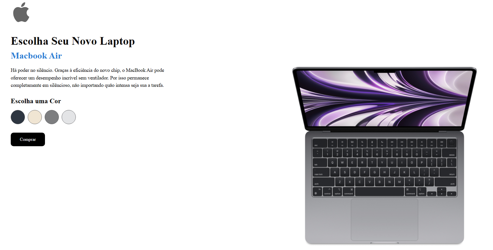
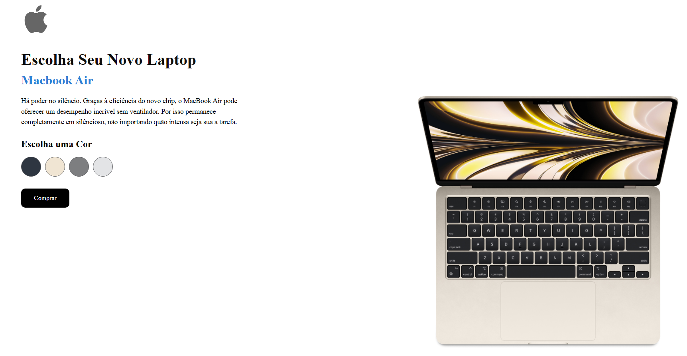

# Laptop Landing Page

Uma página interativa para explorar as cores do MacBook Air.

[Acesse a página ao vivo](https://laptop-lading-page.vercel.app/).

## Sobre o projeto

O projeto apresenta o MacBook Air e permite alternar entre as cores disponíveis. A imagem e o texto alternativo são atualizados junto com a seleção.





## Tecnologias

- HTML5
- CSS3
- JavaScript

## Como usar

1. Clone o repositório:

   ```bash
   git clone https://github.com/Maxdev1017x/Laptop-ladingPage.git
   ```

2. Abra `index.html` no navegador.
3. Use os seletores para visualizar as cores ou clique em **Comprar** para acessar a loja oficial da Apple.

Não é necessário instalar dependências ou executar um servidor.

## Autor

[Maxdev1017x](https://github.com/Maxdev1017x)

## Licença

Distribuído sob a licença MIT. Consulte o arquivo [LICENSE](LICENSE).
